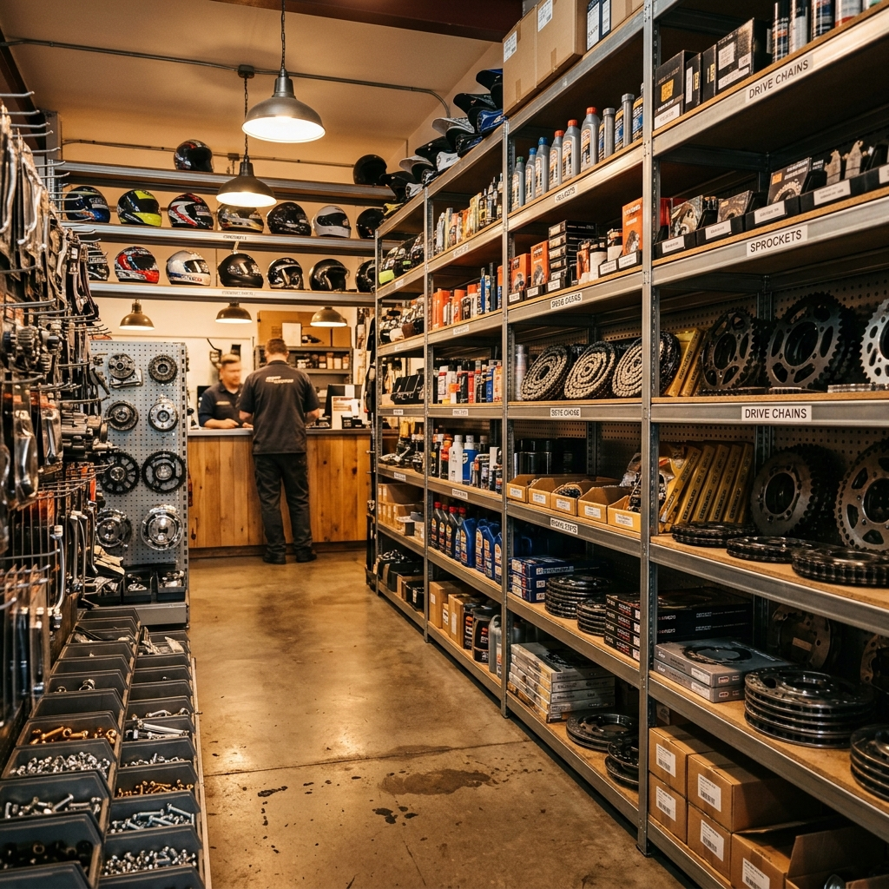

# 🏍️ MotoTrack Management System

> [!IMPORTANT]
> **Premium UI Hybrid Active**: This project is currently on the `premium-ui` branch, which integrates the high-fidelity design from the React prototype into the Laravel functional core.

## How to Revert to Original
If you want to go back to the standard UI:
1. Open your terminal in this directory.
2. Run `git checkout main`.
3. The project will instantly revert to the original functional state.

## New Features (Premium UI)
- **Tabbed Dashboard:** Seamless switching between Overview, Inventory, Sales, and Reports.
- **Modern Aesthetic:** Uses gradients, 3D-effect cards (3xl rounding), and fluid animations.
- **Centralized Command:** One-click access to all functional modules from a single dashboard view.

**MotoTrack** is a professional-grade, automated motorcycle shop management and e-commerce platform. It streamlines shop operations with a Smart POS, real-time inventory tracking, and a seamless customer-to-owner notification bridge.



## 🚀 Core Features

### 🏢 For Shop Owners (Admin Dashboard)
- **Smart POS System**: Rapid checkout interface with automated inventory deduction and transaction grouping.
- **Inventory Management**: Real-time tracking of parts with automated **SMS Low-Stock Alerts** via Semaphore API.
- **Repair Tracking**: Manage service jobs, track progress, and record payments with one-click receipt generation.
- **Pre-Order Processing**: Sourcing management for out-of-stock parts with down-payment verification.
- **Financial Analytics**: Comprehensive sales history and reporting filtered by day, week, or custom date ranges.

### 👤 For Customers
- **Compatibility Checker**: Intelligently filter parts based on motorcycle make and model.
- **Live Order Tracking**: Real-time status updates on repairs (Pending -> Ongoing -> Done).
- **GCash Integration**: Secure online payments for orders and pre-order down payments via **Xendit API**.
- **Real-time Notifications**: Dashboard alerts for order confirmations and status changes.

## 🛠️ Technical Stack

- **Framework**: Laravel 13
- **Frontend**: Blade, Alpine.js, Tailwind CSS (Custom Dark/Light mode)
- **Database**: **PostgreSQL (Supabase)** — *Primary Production Database*
- **APIs**: Xendit (Payments), Semaphore (SMS), Google reCAPTCHA v2
- **Icons**: Lucide Icons
- **Typography**: Inter

## 📈 Professional Features Roadmap

We are currently moving towards a more professional, data-driven architecture. The following features are in the pipeline:

- **[In Progress] Phase 1: Dashboard Analytics** — Visual sales trends and inventory insights using ApexCharts.
- **[Planned] Phase 2: Activity Logging** — Comprehensive audit trails for all administrative actions via Spatie ActivityLog.
- **[Planned] Phase 3: RESTful API Support** — Enabling future mobile app and third-party integrations with Sanctum.
- **[Planned] Phase 4: Automated Testing** — Ensuring stability with Pest PHP automated testing suites.

## ⚙️ Setup & Installation

### 1. Prerequisites
- PHP 8.2+
- Composer
- Node.js & NPM
- PostgreSQL (or MySQL for local dev)

### 2. Installation
```bash
# Clone the repository
git clone https://github.com/yourusername/mototrack.git
cd mototrack

# Install dependencies
composer install
npm install

# Configure environment
cp .env.example .env
php artisan key:generate
```

### 3. Database & Assets
```bash
# Run migrations (ensure DB_CONNECTION is set to pgsql for Supabase)
php artisan migrate

# Compile assets
npm run build
```

### 4. Configuration
Ensure the following keys are set in your `.env` file:
- `XENDIT_SECRET_KEY`: Your Xendit API key
- `SEMAPHORE_API_KEY`: Your Semaphore SMS key
- `SEMAPHORE_NOTIFY_NUMBER`: Owner's notification number
- `NOCAPTCHA_SITEKEY` / `NOCAPTCHA_SECRET`: Google reCAPTCHA keys

## 🛡️ Security & Performance
- **Role-Based Access Control (RBAC)**: Strict owner vs. customer middleware.
- **PostgreSQL Optimization**: Optimized for Supabase cloud hosting.
- **Database Transactions**: Ensures financial data integrity during POS and checkout operations.
- **Optimized UI**: Minimalistic and efficient layout with persistent theme preference (LocalStorage).

## 📝 License
This project was developed for the Capstone Project at Pandi, Bulacan.

---
*Developed with ❤️ by Eivann*
