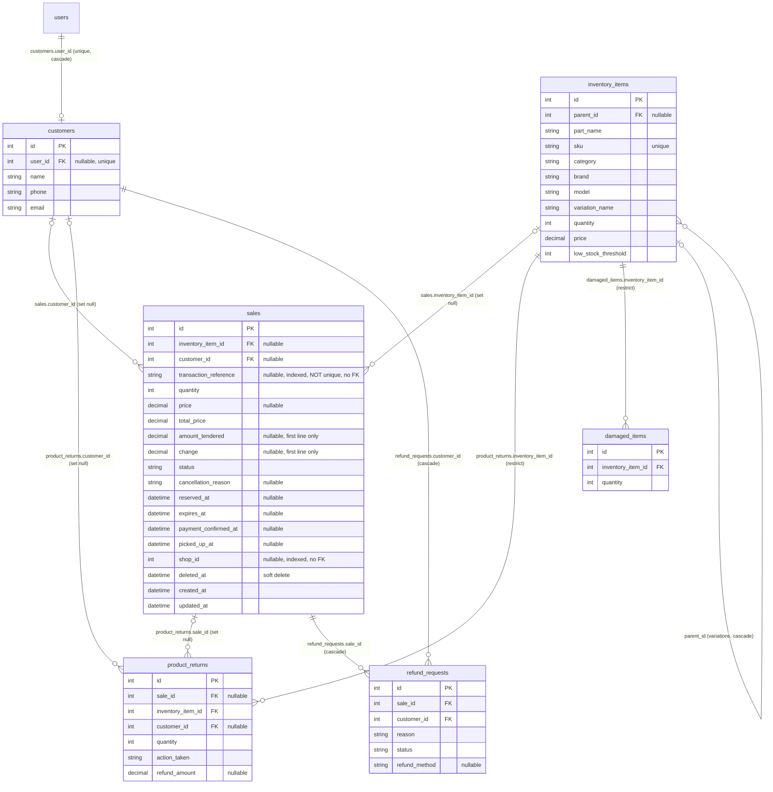
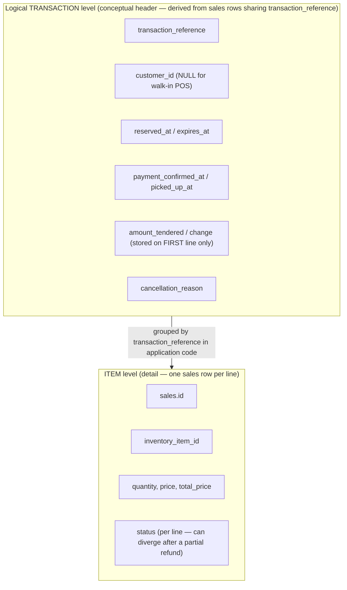

# SYSTEM-4 — Sales Transaction Architecture (Header/Detail)

**Status:** documentation only. No schema, model, controller, receipt or transaction logic was changed for this document.

**Evaluator feedback (SYSTEM-4):**

> "Best practice to use header and detail table (ex. Sales transaction)."

## 0. Honest summary (read this first)

| Question | Answer |
|---|---|
| Does MotoTrack have a separate sales **header table** and **detail table** today? | **No.** There is one table, `sales`, with one row per purchased item line. |
| Is there a transaction-level grouping? | **Yes, logically.** Rows that share the same `transaction_reference` value form one transaction. This is a convention enforced by application code, **not** by a table or database constraint. |
| Does this document fully satisfy the evaluator's recommendation? | **No. It is partial compliance.** It explains and formalizes the current design and defines a safe path to a real header table. The normalization itself is **planned, not implemented**. |

Related, already-delivered database work (SYS4-06 Stage A): eight additive indexes, including `sales.transaction_reference` (`idx_sales_transaction_reference`), so transaction lookups are indexed. This improves performance only; it does not change the structure.

The older Chapter 1–3 ERD (Fig 7.0) is already recorded as outdated in `MOTOTRACK_DIAGRAM_ALIGNMENT_REPORT.md`. The diagram in section 2 covers the sales area only and was checked against the current migrations; it is not a full redraw of Fig 7.0.

## 1. How a transaction is stored today

Every purchase, reservation, repair payment and pre-order payment writes rows into `sales` (soft-deleted via `deleted_at`, and the application never deletes sales; `SaleController::destroy` aborts with 405).

- **Grouping key:** `sales.transaction_reference` (nullable string, **indexed but not unique**, and no foreign key).
  - POS and online checkout: `TRX-<ULID>`, generated once per checkout (`SaleController::storeSale`, `CheckoutController`), then written by `App\Actions\CommitOrder`, one `sales` row per cart line, all with the same reference.
  - Repair payment: `REPAIR-XXXXXXXX` (`RepairController`), one row, `inventory_item_id` NULL.
  - Pre-order payment/pickup: `PRE-XXXXXXXX` (`AdminPreOrderController`), one row.
  - Older rows may have `transaction_reference` NULL. Each such row is treated as its own one-line transaction (receipts label it `TRX-OLD-<id>`).
- **Detail (item) level** is what each row naturally carries: `inventory_item_id`, `quantity`, `price`, `total_price`, and its own `status`.
- **Header (transaction) level** is copied onto every line: `customer_id`, `reserved_at`, `expires_at`, `payment_confirmed_at`, `picked_up_at`, `cancellation_reason`. Payment tender data (`amount_tendered`, `change`) is stored **only on the first line** of the group; the other lines store 0.
- **Application code assembles the header:** receipts, sales history, the customer dashboard and the owner dashboard group rows with `transaction_reference`; reservation cancel and expiry operate on all rows with the same reference (`ReservationService::releaseGroup`); pickup completion (`SaleController::complete`) updates the pending lines of a reference together.
- **Statuses** (`App\Enums\OrderStatus`): `pending` (active reservation), `completed`, `cancelled`, `refund_requested`, `refunded`, `expired`. Status is per row.

## 2. Current database relationships (ACTUAL)

Verified against the migrations in `database/migrations/` (schema listed from a freshly migrated database) and the models. Only real columns and foreign keys are shown. `delete` shows the foreign key's ON DELETE behaviour.

Notes on the diagram:

- `repairs` and `pre_orders` have their own tables (`repairs.customer_id`, `pre_orders.customer_id` and `pre_orders.inventory_item_id` are foreign keys). When a repair or pre-order is paid, a `sales` row is created, but the `sales` table has **no foreign key** back to `repairs` or `pre_orders`. The link exists only through the `REPAIR-`/`PRE-` prefix of `transaction_reference`, so those relationships are intentionally not drawn as keys.
- Only the columns relevant to sales are listed for each table; other columns exist.
- `product_returns.sale_id` and `refund_requests.sale_id` point at **one sales row (one line)**, not at the whole transaction.

## 3. Logical header/detail view (CONCEPTUAL — not tables)

This shows how the single `sales` table is *used* as a header plus detail structure. **The "header" box is not a database table.**

## 4. Worked example (fictional data only)

A customer reserves three items online. Reference `TRX-EXAMPLE0001`, customer id `7` ("Juan Dela Cruz").

**After checkout (all lines `pending`; reservation created, stock already reduced):**

| sales.id | transaction_reference | inventory item | qty | price | total_price | status | amount_tendered | change |
|---|---|---|---|---|---|---|---|---|
| 101 | TRX-EXAMPLE0001 | Brake Pad | 2 | 350.00 | 700.00 | pending | 0 | 0 |
| 102 | TRX-EXAMPLE0001 | Chain Kit | 1 | 1,200.00 | 1,200.00 | pending | 0 | 0 |
| 103 | TRX-EXAMPLE0001 | Spark Plug | 4 | 120.00 | 480.00 | pending | 0 | 0 |

Transaction total (sum of `total_price`): **2,380.00**.

**After pickup and payment of 2,500.00** (`SaleController::complete`): each pending line becomes `completed`, `payment_confirmed_at` and `picked_up_at` are set on all lines, and the tender is stored on the first line only:

| sales.id | status | amount_tendered | change |
|---|---|---|---|
| 101 | completed | 2,500.00 | 120.00 |
| 102 | completed | 0 | 0 |
| 103 | completed | 0 | 0 |

**After the owner records an in-store return for the Chain Kit line only**: only line 102 changes.

| sales.id | status |
|---|---|
| 101 | completed |
| 102 | refunded |
| 103 | completed |

The transaction now has **mixed statuses**. Reading "the" transaction status from one row is therefore a convention, not a stored fact.

In MotoTrack's in-store refund process the owner records the return at the counter through the inventory adjustments page (`InventoryAdjustmentController::storeReturn`). For this example the owner returns the Chain Kit (quantity 1, linked to `sale_id = 102`, `refund_amount = 1,200.00` as entered). The code then creates a `product_returns` row, either adds the quantity back to inventory (`action_taken = restocked`) or records a damaged-stock write-off (`discarded`), and sets line 102 to `refunded` once the quantity returned against that line reaches the line's quantity.

Two related facts: (1) the customer-facing online refund request is **disabled** (`CustomerOrderController::requestRefund` returns "Online refund requests are not supported"), so the code does not create new `refund_requests` rows; (2) `RefundController::approve` still exists for any pending `refund_requests` rows that are already present. When it approves one, it sets the line to `refunded` and, only if that line has an inventory item, creates a `product_returns` row and then restocks or writes off the stock. A line without an inventory item (for example a repair payment) is marked `refunded` but gets no `product_returns` row.

> This section describes how the code is *intended* to behave. Returns and refunds are a known open area: independent audit finding **BIZ-03** is unresolved and is tracked separately, so this document makes no claim that the return/refund workflow is fully protected against over-refunding.

**Other cases of the same structure:**
- Walk-in POS sale: same shape, but `customer_id` is NULL.
- Legacy sale: `transaction_reference` is NULL; the single row is the whole transaction.
- Repair or pre-order payment: one row with a `REPAIR-`/`PRE-` reference.

## 5. Limitations of the current single-table design

1. **No header entity.** Nothing in the database guarantees that rows sharing a reference belong together, and `transaction_reference` is not unique or a foreign key (it cannot be unique on `sales`, because every line shares it).
2. **Duplicated transaction-level data.** `customer_id`, timestamps and `cancellation_reason` are repeated on each line; the database cannot stop them from drifting between lines of one transaction (application code keeps them in sync).
3. **Payment data lives on one line.** `amount_tendered` and `change` are on the first line only. Receipts read them with `$sales->first()`.
4. **Status is per line.** A transaction can have mixed statuses after a partial refund; counting transactions needs `DISTINCT transaction_reference` plus a separate NULL branch for legacy rows.
5. **Returns and refunds attach to a line**, not to the transaction.
6. **Repair/pre-order payment rows have no foreign key** to the repair or pre-order they paid for.
7. **Legacy NULL references** need special handling in reports and receipts.

## 6. Potential separate correction — first-line tender/change ordering (NOT FIXED here)

- **Issue:** the receipt queries load a transaction's lines **without an `orderBy`**, then the views read the payment data from `$sales->first()`. PostgreSQL does not guarantee row order without `ORDER BY`. In practice rows usually come back in insertion order, which is why this appears to work, but it is not guaranteed. If a different row came first, the receipt could show no cash tendered or a wrong change.
- **Where:**
  - Queries without `orderBy`: `SaleController.php` (`resolveSalesByPrimaryKey`, `receipt`, `downloadReceipt`) and `CheckoutController.php` (`receipt`, download).
  - Views that read the first line: `resources/views/sales/receipt.blade.php`, `sales/pdf_receipt.blade.php`, `shop/receipt.blade.php`.
- **Proposed minimal fix (not applied):** add `->orderBy('id')` to those queries so "first line" is deterministic and matches where `CommitOrder` and `complete()` write the tender. No schema change. Add a regression test with lines created in a non-trivial order.
- **Scope:** handle as its own small stage, separate from this documentation and from the header/detail work. Receipt queries were **not** modified in this stage.

## 7. Proposed path to a real header/detail design (PLANNED — not implemented)

### 7.1 Target (additive; `sales` stays as the detail table)

- New table `sale_headers`: `id`, `transaction_reference` (unique), `type` (`pos`, `online`, `repair`, `preorder`), `customer_id` (nullable FK, set null on delete), `reserved_at`, `expires_at`, `payment_confirmed_at`, `picked_up_at`, `amount_tendered`, `change`, `cancellation_reason`, timestamps.
- New nullable column `sales.sale_header_id` (FK to `sale_headers`, nullable, indexed). `sales` keeps all of its existing columns. The `sales` table is not renamed or dropped.
- Item-level status stays on `sales` (it legitimately differs per line after a partial refund).

### 7.2 Phased strategy (rollback difficulty grows with each phase)

| Phase | Work | Production impact | Rollback (see 7.2.1) |
|---|---|---|---|
| 0 | Read-only pre-flight checks (run by the owner): count of NULL references; references shared by more than one `customer_id`; tender stored on a non-first line; soft-deleted lines | None | n/a |
| 1 | Additive migration: create `sale_headers`, add nullable `sales.sale_header_id` + index (PostgreSQL: concurrent, non-transactional like the SYS4-06 index migration) | No behaviour change | Relatively safe while nothing uses them: drop the column, then the table |
| 2 | Dual-write for **new** transactions in `CommitOrder`, repair payment and both pre-order payment paths, inside the same database transaction; existing line columns keep being written | New rows only | Revert the code, but headers already written must be reconciled or deleted first |
| 3 | Backfill command (**a separately reviewed command, run explicitly — never part of a migration or a deploy**): dry-run by default, chunked, idempotent, one header per distinct reference; each legacy NULL-reference row gets its own header (reference `TRX-OLD-<id>`, matching receipt labels) without altering `sales.transaction_reference`; tender copied from the first line | Existing sales gain a header link only | Only after reconciliation: record which rows were linked, then set `sale_header_id` NULL and remove those headers |
| 4 | Verification: header count = distinct references + legacy rows; sum of `total_price` per header unchanged; no lines left unlinked | None | n/a |
| 5 | Switch reads (receipts read tender from the header with a first-line fallback; dashboards count headers) | Read paths only | Revert the code or use a flag, provided the line columns are still being written |
| 6 | Optional, much later: retire duplicated columns on `sales` | **Destructive** | **Not automatically reversible**; only from a verified backup |

#### 7.2.1 Rollback caveats

- **Additive schema changes** (a new table, a nullable column, an index) have a relatively safe rollback path **before anything depends on them**: drop the column, then the table. Once code writes to or reads from them, rolling back means undoing that data and code too.
- **Dual-written or backfilled data requires reconciliation before rollback.** New rows written after phase 2, and rows linked in phase 3, must be reconciled (which headers exist, which lines point to them, whether totals still match) before the link or the headers are removed; otherwise data entered after the rollout can be lost or left inconsistent.
- **Dropping duplicated columns (phase 6) is destructive** and must not be treated as reversible. Restoring them depends on a verified backup, and values changed after the drop cannot be recovered from the application.
- **Any real production rollout needs** a fresh backup or point-in-time marker, verification queries before and after each phase, and explicit owner approval. Nothing in this document has been executed.

### 7.3 Safeguards (any production step)

- Take a backup or point-in-time marker first; run the backfill during a quiet window.
- **Deployment does not run migrations.** `.github/workflows/deploy.yml` is started manually (`workflow_dispatch`), runs the tests, and deploys the code ("Deploy verified commit (no migrations)"). It does not run `php artisan migrate`. A production migration or backfill is therefore a separate, explicitly executed and reviewed step (the SYS4-06 indexes were applied as a separate, deliberate step, not by the deploy), and code that needs a new column must not be deployed before that column exists.
- Do not put the backfill inside a migration; run it as its own command so it can be dry-run, reviewed and verified first.
- Compare per-reference totals before and after; keep `sales` rows untouched.
- Do not change refund/return foreign keys until phase 5 has been verified.

### 7.4 Tests the later work should add

Backfill (one header per reference; legacy rows; idempotent; dry-run; totals preserved; mixed statuses preserved); dual-write for POS, online checkout, repair payment and pre-order payment; receipts and dashboards unchanged; existing suite passes unchanged.

## 8. Implemented now vs planned

| Item | Status |
|---|---|
| Multi-line transactions grouped by `transaction_reference` | **Implemented** (application convention) |
| Single `sales` table, one row per item line | **Implemented** |
| Index on `sales.transaction_reference` and foreign-key indexes (SYS4-06 Stage A) | **Implemented, verified in production** |
| This architecture document and diagrams | **Done (documentation only)** |
| Separate `sale_headers` table and `sales.sale_header_id` | **Planned — not implemented** |
| Backfill of existing sales | **Planned — not implemented** |
| Deterministic ordering for first-line tender/change | **Identified — not implemented** |

## 9. What can be demonstrated to evaluators today

All of this works in the existing application and should be described as the current single-table design, not as a header/detail table pair.

1. **Multi-item sale as one transaction.** Record a POS sale with several items. Sales history and the receipt show one transaction with one reference and several lines (`tests/Feature/Sales/SalesHistoryReceiptTest.php`, "by-id receipt returns ALL lines of a multi-item transaction").
2. **Transaction-level actions.** Reserve several items online, cancel the reservation, and show that all lines and stock are released together; or complete pickup and show one combined cash total and one change figure (`ReservationPickupTest`, "a multi-line reservation completes in one action…").
3. **Item-level history.** Show that a refund applies to one line of a multi-item sale and that reported revenue is reduced by that line's refund amount (`PosRefundTest`, "partial refund on multi-item sale…"). Present this as how the workflow is intended to work; return/refund validation is still under independent audit finding **BIZ-03** (unresolved), so do not describe refunds or returns as fully protected.
4. **Data protection.** Sales are never deleted (the delete action returns 405), and checkout and pickup lock the affected rows while updating them. Return and refund handling includes intended validation and inventory safeguards (for example, checks against previously returned quantity and stock restoration or write-off), but these are not presented as guarantees while BIZ-03 remains unresolved.
5. **Performance work tied to the feedback.** Show the new indexes (`idx_sales_transaction_reference` and the foreign-key indexes) and this document's ERD and example.
6. **Candid design answer.** State that the header/detail split is currently implemented as a convention over one table, explain the limitations in section 5, and present section 7 as the planned, phased path, with the rollback caveats in 7.2.1.
